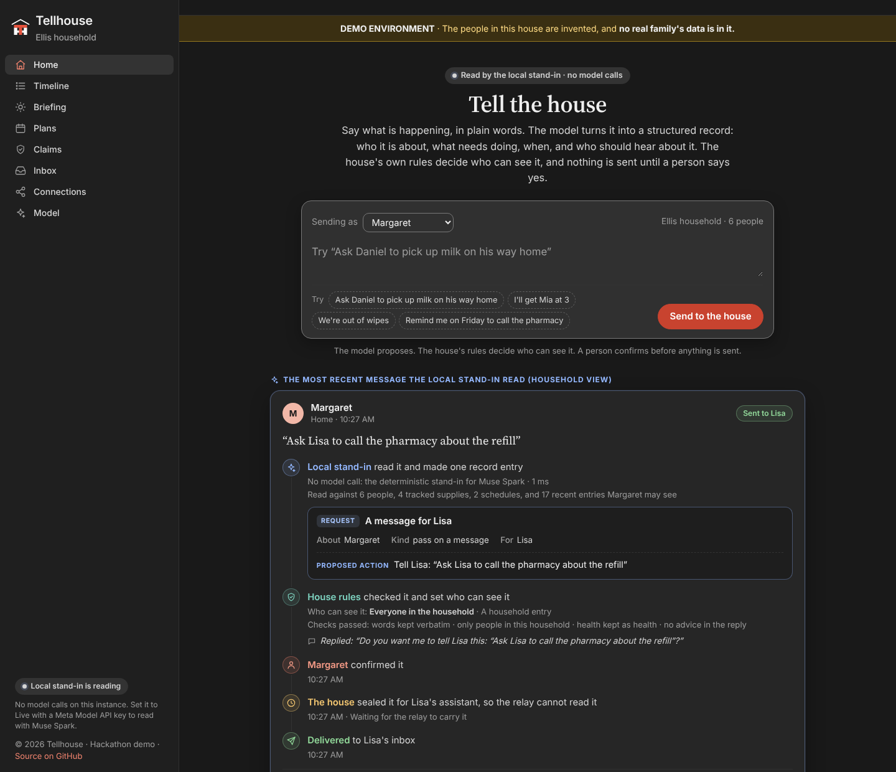

# Tellhouse — the house that remembers

One shared record for any household: tell it once, it writes it down, and it asks before it tells anyone.

**It's your time, spend it doing what you want to do.**

People tell Tellhouse what is happening, who is doing what, who is available, what is running low, and what needs picking up. The house turns each message into an entry in a shared record. When something is meant for one person, Tellhouse tells that person and no one else, and only after someone confirms it.

Claims stay visible as claims, so a person who is waiting can see who has taken something on. Entries are shown to the people their stored audience allows. Not everyone hears everything.

Tellhouse coordinates a household: it records, reminds, and relays between the people in it. It does not give medical advice, diagnoses, or treatment recommendations. Anything health related is written down in the person's own words and handed to a person.

In many households, the person who knows first what is needed may also be the person who needs support. Tellhouse gives them a way to speak into the system in their own words. Margaret can tell the house what she needs; the record is updated once a person confirms it, and what she asked to pass on reaches the person it names. The everyday coordination around that moment, including whereabouts, groceries, and supplies running low, belongs in the same record.

Tellhouse is for any household and for the people that household chooses to include: family near or far, friends, neighbors, sitters, and helpers, whether or not they live under the same roof. It is personal: one household, its own shared record.

An agent proposes, a human confirms, and there is a written record of both.

## Try the live demo

**Live demo:** https://tellhouse.onrender.com

The first load may take a minute while the services wake.

1. Open Home and send a short message, such as “We're out of milk.”
2. Confirm what Tellhouse proposes, then look for the entry in Recent and Timeline.
3. Open Inbox and Connections to see how a message reaches one person and how a member's assistant joins the household.

*Screenshot: Tellhouse Home, served from the build in this repository. The rail lists the house's surfaces, the message box is where a person tells the house something in their own words, and Recent shows what the record already holds.*

## This demo

Demo: the people in this house are invented, and no real family's data is in it.

The demo is open on purpose: anyone with its link can look around and try messages, because everyone in it is invented. That openness belongs to the demo. In the product, a house's record is not public: it is visible only to the household's own members, each through the door, under the audience stored on every entry.

Demo data and public release, stated plainly: this repository is populated with demo data for demo purposes. The household, its people, and its records are invented. The keys, phrases, and tokens in the demo seed are toy material published for the demo; the live deployed demo runs on fresh values set at deployment time, not on anything in this repository. Some functionality is limited or removed in this public release version.

There is no Tellhouse app to install. Home is where a person sends the house a message in their own words, and the shared record is what the household can read. In the live configuration, a message is understood by Meta's Muse Spark model, through the Meta Model API, into record entries. A person confirms what needs confirming, and the confirmed record is what the house works from. The model proposes structured events; the house's own machinery confirms, routes, and records them. By default, the local demo runs the same path on a deterministic local stand-in.

The deployed demo uses separate services for the home node, the sealed relay, and the two member stand-ins. The home node holds the record and the door. The relay carries messages it cannot read. Each stand-in is a reference assistant for a fictional member, built to the house protocol.

The house layer's surfaces are:

- **Home:** send a message to the house and ask it questions.
- **Timeline:** the shared record, newest first.
- **Briefing:** what matters to one person, filtered by who is asking.
- **Plans:** what the household is arranging, who agreed, and what is still open.
- **My Claims:** what people have taken on, in their own words.
- **Inbox:** what the house has delivered to one person.
- **Connections:** who is connected to the house, and through which assistant.

## Run it locally

Run the home node:

    dotnet run --project src/HomeNode

Then open Home in a browser. On first start, the demo seeds a fictional household and one ordinary day. Extraction defaults to a deterministic local stand-in, so the demo runs with no API key and no spend.

To run the same extraction path with Meta's model, supply a Meta Model API key through the environment. The repository's `.env.example` shows the variable name, `MODEL_API_KEY`, with a redacted value.

Set the real `MODEL_API_KEY` in the host's secret store or environment, never in the repository. Set the extraction mode to Live and the model to `muse-spark-1.3` (Muse Spark) in the host configuration. DEPLOY.md documents the live configuration used for the judged demo environment, including the deployed environment-variable form.

The relay and the stand-ins are separate services, started alongside the home node when you want the full federated demo. The relay is a Python service (see `relay/README.md` for its configuration and start command), and each stand-in is its own project under `standins/` (see the README in each stand-in's folder for the environment it needs). `src/HomeNode/README.md` describes how the node talks to both.

TEST-EVIDENCE.md records what was run against the code in this repository and what it showed.

## Built on open source

Tellhouse stands on open-source projects, and on one model:

- .NET and ASP.NET Core (MIT): the home node, the two stand-in assistants, the backup tool, and the protocol library are C# on .NET 10, and Home is ASP.NET Core Razor Pages.
- Entity Framework Core (MIT) with its SQLite provider: the house record lives in a SQLite database (SQLite is public domain).
- Python 3 (PSF), standard library only: the sealed relay.
- Bootstrap 5.3.3 and jQuery 3.7.1 (both MIT), with the jQuery Validation plugins, vendored under `wwwroot/lib`: Home's styling and client scripts.
- Muse Spark, Meta's model, through the Meta Model API: the model call at the center of the design. It reads a message in a person's own words and returns the structured events the house then works from.

What we built on top of them is the house itself: the shared record and Home, the confirmation step a person takes before anything is settled on the record, the audience rules that decide who may see and be told what, the sealed member protocol and the relay that carries messages it cannot read, the door ceremony that connects a member's own assistant, and the sealed backup and restore that also powers the demo reset.

Standalone: this repository runs on its own. Nothing in it depends on any pre-existing Tellhouse infrastructure; the only outside service it calls is the Meta Model API, with the key supplied as the `MODEL_API_KEY` environment variable (see `.env.example`).

## Where this is going

Direction: Tellhouse is being built so the house's record lives in the home, on a device the household controls; our servers would carry messages between the house and its members, never keep the memory.

Our pledge for that direction: we will not keep your data, we do not want it, and we will never sell it. In this demo, message text is sent to the Meta Model API to be understood in the live configuration. We are here to facilitate. The house coordinates between the people in it and, as the direction builds out, between each person's own assistant where they have one, as much or as little as each person chooses.

## Provenance

The idea grew out of how one household already keeps each other informed day to day, as a practice. No working version of Tellhouse existed before this event: the concept was created after the hackathon was announced, transformed entirely once the event started, and evolved organically in Bryan Hamilton's household out of a household need. The code, the data model, the screens, and the demo were designed and built entirely during the event; no pre-existing code, screens, or footage are used.
